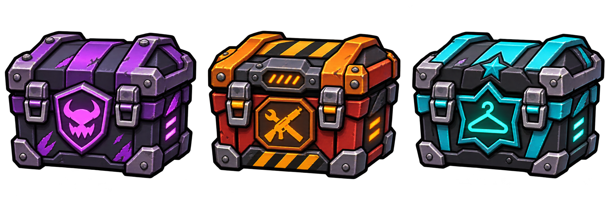

# MAYHEM GARAGE — Ausbauplan und Entwicklungsstand
RF Worlds | Mayhem Survivors | Zielupdate 0.18 | 2026-11-17

**Status: Entwicklungsentwurf. Kein spielbares 0.18-Update, keine neue APK.**
Die Entwicklungsumgebung ist während der Implementierung offline gegangen.
Gesichert sind neue Case-Grafik, Katalog, ein noch nicht integriertes Sammlungsmodell
und vorbereitete Godot-Tests. Menüs, Ausrüstungsdarstellung, Zauber, Migration und
Kampfanbindung sind noch offen. Der bisherige spielbare Stand bleibt0.17.

## Das Ziel
Ein Run liefert Beute für eine dauerhafte Sammlung. Spieler bauen ihren Fighter aus,
sehen ihre Ausrüstung und haben neben dem nächsten Sieg konkrete Sammelziele.

Spielen → Studio-Coins/Tickets → Case öffnen → Fighter oder Ausrüstung erhalten →
im Inventar vergleichen → ausrüsten/verbessern → mit eigenem Build weiterkämpfen.

Die vorhandenen Kampfwerte bleiben die Grundlage. Ein großes Menü allein ersetzt
keine Entscheidungen im Kampf. Fortschritt soll neue Spielweisen und sichtbare
Belohnungen schaffen; Boni bleiben begrenzt und werden mit realen Runs abgestimmt.

## 1. Crew und Startregel
- Bruiser und sein Hammer sind frei.
- Sparky, Shade, Twinkle, Kicksy und Steelfist werden über Crew-Cases freigeschaltet.
- Ein neuer Fighter bringt seinen passenden Startwaffen-Bauplan mit.
- Gesperrte Fighter bleiben mit Illustration, Rolle, Fähigkeit und Fundort sichtbar.
- Bestehende Klassenwaffen bleiben gebunden; neue Ausrüstung erzeugt keine vier Hände.
- Tutorial kann einen eindeutig gekennzeichneten Leihhelden nutzen. Das schaltet ihn
  nicht für normale Runs frei und darf keine Case-Währung farmen.

Die Regel soll entsprechend dem neuen Auftrag auch bisherige Gratisfreigaben ersetzen.
Statistik, erspielte Studio-Coins und vorhandene kosmetische Käufe bleiben erhalten.
Vor der Umstellung wird der alte lokale Spielstand gesichert. Alte Meisterschaften
und Farbvarianten werden aufbewahrt. Das darf erst nach getesteter Migration ausgeliefert werden.

## 2. Drei Cases
| Case | Inhalt | Preisvorschlag |
| --- | --- | --- |
| Crew | Ein zusätzlicher Fighter | 100 Studio-Coins |
| Arsenal | Waffenbaupläne, passive Items oder zusätzliche Zauber | 60 Studio-Coins |
| Style | Kopf, Rüstung/Kleidung, Schuhe, Waffenstile und Dekoration | 40 Studio-Coins |

Einmalig ein kostenloses Startticket je Caseart. Cases sind erspielbar, ohne Echtgeld,
Werbung oder Internet. Preise sind erste Abstimmungswerte, keine gemessene Ökonomie.

Crew-Gewichte: Sparky30, Shade25, Twinkle20, Kicksy15, Steelfist10.
Nach zwei Crew-Duplikaten garantiert der nächste Crew-Case einen fehlenden Fighter.
Dabei werden die Gewichte der fehlenden Figuren neu normalisiert. Sobald alle vorhanden
sind, ist die Sammlung vollständig; Menü und Chancen müssen das offen anzeigen.

Arsenal: acht Waffen mit je5 Gewicht, drei passive Items mit je10, drei Zauber mit je10.
Style: neun Ausrüstungsteile, drei Waffenstile und sechs vorhandene Dekorationen.
Die tatsächlichen Einzelchancen werden aus dem Katalog berechnet und angezeigt,
einschließlich einer aktiven Crew-Garantie. Keine erfundenen Fast-Gewinne in der Animation.

Duplikate geben Werkstattteile: Standard20, Selten35, Episch60. Sie löschen keine
vorhandenen Gegenstände und ersetzen keine bereits gewählten Ausrüstungen.

## 3. Case Opening als echter Ablauf
Kiste wählen → Preis/Ticket und Chancen sehen → Öffnen → kurze Shake-/Lichtanimation →
tatsächlichen Fund zeigen → im Inventar ansehen oder ausrüsten.
Animation überspringbar; große Touchziele; reduzierte Bewegung berücksichtigen.

**Technisch erforderlich, noch nicht integriert:**
- Kosten, Zufallsergebnis, neue Eigentümerschaft und Öffnungsbeleg gemeinsam lokal speichern.
- Erst danach die Aufdeckanimation zeigen. Schreibfehler rollen die gesamte Buchung zurück.
- Ein ausstehender Beleg blockiert weitere Öffnungen. Nach App-Neustart denselben Fund
  erneut anzeigen, ohne ihn noch einmal zu vergeben oder die Kiste neu zu würfeln.
- Schnelltippen und Mehrfingereingaben dürfen weder doppelt bezahlen noch doppelt belohnen.
- Case-Zufall verwendet einen eigenen gespeicherten Generator und beeinflusst Kampf-RNG nicht.
- Der Prototyp verändert nur Dictionaries. Persistenz/Transaktionen müssen darüber ergänzt werden.

## 4. Fighter-Menü und Inventar
Große Figur mit einer Ausrüstungsvorschau, die der tatsächlichen Spielfigur entspricht.

Slots je Fighter:
- Kopf: Helm, Visier oder Maske.
- Körper: Weste, Panzer oder Jacke.
- Füße: Stiefel/Schuhe.
- Waffe: freigeschaltete passende Startwaffe; Sparky kann zwischen seinen Bauplänen wählen.
- Passives Item: ein Modul.
- Zauber: eine zusätzliche aktive Fähigkeit.
- Waffenstil: rein optische Farb-/Leuchtvariante.

Ringe, Begleiter und Spielertitel verwenden zunächst das vorhandene globale Dekosystem,
im Menü klar als für alle Fighter bezeichnet. Bestehende direkte Studio-Shop-Käufe
bleiben möglich und müssen mit Case-Funden dieselbe Eigentümerschaft teilen.

Karten zeigen Fundort, Seltenheit, Werkstattrang, tatsächliche Werte, Verbesserungskosten
und die Klassenbindung. Gesperrte/ungeeignete Gegenstände lassen sich ansehen, aber nicht
ausrüsten. Keine Änderungen an einem bereits laufenden Run über Hintergrund-Menüaktionen.

## 5. Dauerhafte Werkstatt und Run-Upgrades
Dauerhafte Werkstattränge1–5 sind getrennt von Waffenlevel1–5 innerhalb eines Runs.
Beides muss im UI eindeutig beschriftet werden.

Vorgesehene Kosten zum nächsten Werkstattrang:20/35/55/80 Teile.
- Waffen: Rang1 hat keinen Bonus, danach je Rang +2% Waffenschaden, maximal +8%.
- Körperausrüstung: +1 Rüstung je Rang.
- Schuhe: +1% Tempo je Rang.
- Kopfausrüstung: +2 Sammelradius je Rang.
- Passive Module: Lebenskern +5HP, Schutzkern +1Rüstung oder Sammlerkern +10 Radius je Rang.
- Dekoration und Waffenstile geben keine Kampfwerte.

Für jede neue Run-Instanz wird eine feste Kopie der gewählten Ausrüstung erstellt.
Gekaufte Run-Upgrades, Gegenstände und Sets rechnen auf diesen Startwerten weiter.
Keine doppelte Anwendung beim Laden, Menüswechsel oder nächsten Wellenstart.
Steelfists Basiswerte und vierter Schlag bleiben erhalten; ausgerüstete Boni werden
getrennt angezeigt und später über tatsächlich gespielte Runs abgestimmt.

## 6. Sichtbare Anpassungen
Es reicht nicht, nur Symbole oder Werte zu wechseln.
Kopfteil, Körperausrüstung und Schuhe müssen im Charaktermenü und im Kampf sichtbar sein.
Separate Ausrüstungslayer mit passenden Ankern für alle sechs Figuren verwenden.
Die vorhandenen armlosen Basen und genau zwei animierten Hände beibehalten.
Waffenstile verändern die gehaltenen Waffen; bestehende Begleiter/Ringe bleiben sichtbar.
LOW/MEDIUM/HIGH verändern ausschließlich Darstellung und Effektanzahl.

Erster Katalog:
- Baustellenhelm, Neonvisier, Schädelmaske.
- Schrottweste, Reaktorpanzer, Mayhemjacke.
- Stahlkappen, Neonsohlen, Raiderstiefel.
- Cyan Core, Ember Edge, Void Steel.
Grafik/Anker dieser Ausrüstung sind noch zu erstellen und auf allen Helden zu prüfen.

## 7. Zusätzliche Zauber
Ein zusätzlicher Zauberslot, die individuelle Heldenfähigkeit bleibt erhalten.
- Heilimpuls:11–15% Max-HP heilen,45s Cooldown.
- Frostnova: kurzer Flächentreffer und2s Verlangsamung,35s Cooldown.
- Phasensprung: begrenzter Sprung in Bewegungsrichtung mit kurzer Unverwundbarkeit,
  je Rang40–32s Cooldown, Arena-Grenzen beachten.

Das sind Katalogentwürfe, noch keine implementierten Zauber.
Zweite Touch-Schaltfläche getrennt von Joystick und Heldenfähigkeit; Multitouch,
Pause, App-Unterbrechung, Levelwahl und Shop dürfen keine Simulation weiterlaufen lassen.

## 8. Belohnungsökonomie
Run-Coins bleiben für den Waffenladen innerhalb des Durchlaufs.
Studio-Coins dienen der dauerhaften Sammlung und Cases.
Werkstattteile kommen zunächst aus Duplikaten und verbessern freigeschaltete Ausrüstung.
Keine zusätzliche Premiumwährung.

Vorgeschlagener Studio-Runbonus:5 pro tatsächlich überlebter Welle, bis10 für Kills
(1 je50),20 für einen Kampagnensieg; maximal500 pro Run. Training zählt nicht.
Tages-/Wochenaufgaben und kostenloser Pass kommen dazu.
Erste Weltabschlüsse sollen später feste Cases und neue Welten öffnen.

## 9. Nächste Umsetzungsschritte
1. Modell mit Godot importieren und vorbereitete Tests tatsächlich ausführen.
2. Versionierte Speicherergänzung, Roster-Regel, atomare Buchung und alte Profile testen.
3. Case-Menü mit tatsächlicher Öffnung/Ergebnis/Chancen und Inventar anschließen.
4. Werkstatt, Loadouts und feste Kampfwerte integrieren.
5. Ausrüstungslayer und drei tatsächliche Zauber einschließlich Touchsteuerung umsetzen.
6. Belohnungen/Ergebnisbildschirm, Tutorial und Aufgaben verbinden.
7. Regression aller bisherigen Inhalte, native UI-Prüfung, Lastprobe und Android-Build.
8. Danach Weltfortschritt: Schrottplatz → Neonhafen → Reaktorzone → Glutwerk.

Vor Freigabe muss der komplette Ablauf ohne manuelle Programmierung spielbar sein.
Insbesondere darf niemand Cases öffnen und anschließend wirkungslose oder unsichtbare
Pflichtausrüstung erhalten.

## 10. Weitere sinnvolle Ausbaustufen
- Eigene Garage als Startbereich: Werkbank, Waffenschrank und Trophäenregal.
- Sichtbare Boss-Trophäen und besondere optische Sets pro Welt.
- Mehr seitliche Build-Entscheidungen statt unbegrenzt stapelbarer Prozentboni.
- Klare Vorschau von Setwirkungen und Vergleich vor dem Ausrüsten.
- Wochenherausforderungen mit festen Belohnungen und eigener Auszeichnung.
- Erst nach funktionierendem Kern mehr Seltenheiten und zusätzliche Casearten.

## Ehrlicher Prüfstand
Katalog in JavaScript auf32 Item-IDs, fünf Zusatzhelden, gültige Slots, Fundorte,
positive Gewichte und gültige Startwaffenreferenzen geprüft.
Gewichtssummen: Crew100, Arsenal100, Style120; Einzelchancen werden normalisiert.
Das ersetzt weder Godot-Parserprüfung noch Gameplay-/Speicher-/Android-Tests.
Vorbereitete Godot-Tests sind nicht ausgeführt. Keine0.18-APK und kein fertiges Menü.
