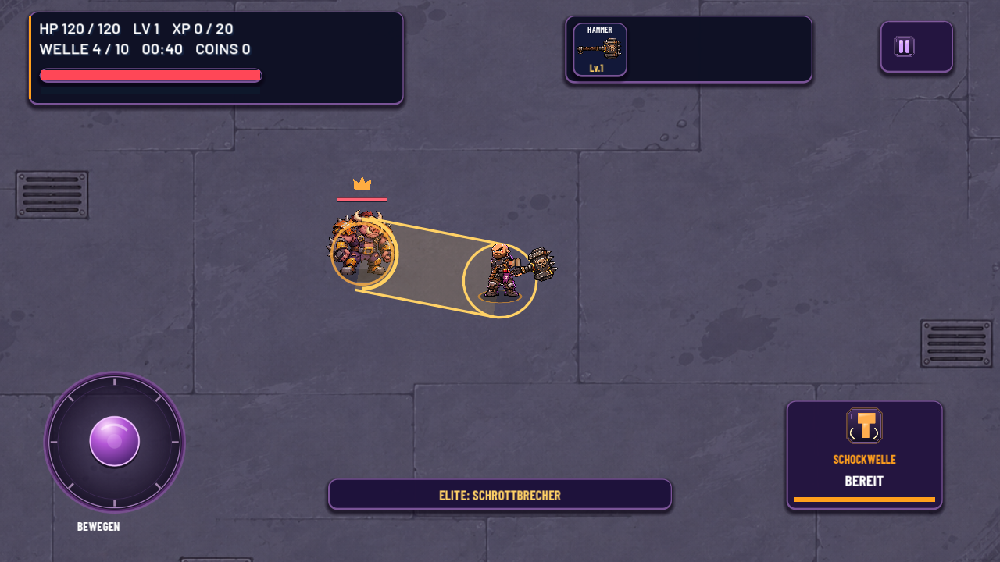

# RF Worlds — Mayhem Survivors 0.10.0

**Elitegegner, besondere Beute und zusätzliche Bossphasen für beide Arenen.**

- Schrottbrecher: fixiert angekündigter Sturm, mit Schockwelle unterbrechbar.
- Impulswächter: angekündigter Ring mit echter türkiser Fluchtöffnung.
- Maximal eine Elite in Welle 4/6/8/9, ab Sekunde 18, innerhalb des bisherigen Gegnerlimits.
- Nach dem Sieg über Elite: im nächsten Shop genau eine zusätzliche Run-Belohnung wählen.
- Beide Bosse wechseln bei 65/30 % HP Muster; klare Warnungen und kurze Erholung.
  Boss-HP/Zeit unverändert, Grundangriffe bleiben zwischen Zusatzmustern erhalten.

[Android-APK 0.10 herunterladen](https://github.com/Whiskymitschuss/Match3/raw/refs/heads/feature/elite-encounters-v0.10/Downloads/MayhemSurvivors-v0.10-debug.apk)

[Vollständiges Quellprojekt ZIP](https://github.com/Whiskymitschuss/Match3/raw/refs/heads/feature/elite-encounters-v0.10/Downloads/MayhemSurvivors-v0.10-source.zip)

[Beutewahl](MayhemSurvivors/tests/encounter_elite_cache.png) ·
[Reaktor-Bossphase](MayhemSurvivors/tests/encounter_guardian_phase_three.png)

1.030 Assertions, historische Traces und begrenzte Lastproben bestanden. APK exportiert/
signiert, Android-Hardwareabnahme der neuen Kämpfe noch offen. 0.9 vom Nutzer positiv
bestätigt; neue Mechaniken verlangen neue Fairness-/Performance-Abnahme auf Gerät.
Android 7.0+, ARM64, offline, Querformat, gleicher Paketname/Schlüssel, Code 14.
Als Update installieren; lokale Statistik/Einstellungen bleiben erhalten.

[Anleitung](MayhemSurvivors/README.md) · [Tests](MayhemSurvivors/TEST_REPORT.md) ·
[Build](MayhemSurvivors/BUILD_REPORT.md) · [Fortschritt](MayhemSurvivors/PROGRESS.md)
