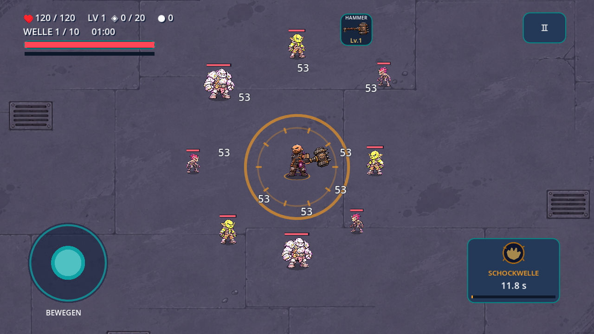

# RF Worlds — Mayhem Survivors 0.4.0

**Eigene aktive Fähigkeiten für die drei Helden**, großer rechter Touchbutton mit
Abklinganzeige, stärker unterscheidbare Schadensanzeigen und optionale Vibration.

| Held | Fähigkeit |
|---|---|
| Bruiser | Schockwelle mit Flächenschaden und Rückstoß |
| Sparky | Automatisch gezielte Impulsgranate mit Verlangsamung |
| Shade | Schattenschritt mit Durchquerungsschaden und kurzer Unverwundbarkeit |

- [Android-APK 0.4 herunterladen](https://github.com/Whiskymitschuss/Match3/raw/refs/heads/feature/hero-abilities-v0.4/Downloads/MayhemSurvivors-v0.4-debug.apk)
- [Vollständiges Quellprojekt als ZIP](https://github.com/Whiskymitschuss/Match3/raw/refs/heads/feature/hero-abilities-v0.4/Downloads/MayhemSurvivors-v0.4-source.zip)
- [Granatenexplosion](MayhemSurvivors/tests/ability_sparky_explosion.png) · [Schattenschritt](MayhemSurvivors/tests/ability_shade.png)

Android 7.0+, ARM64, Querformat, offline. Als Update über die bestehende App installieren:
gleicher Paketname/Schlüssel, versionCode 7. Statistik und Freischaltungen bleiben erhalten.
Vibration ist standardmäßig AUS; die App deklariert dafür `VIBRATE`, kein Internetzugriff.
Die Schrottplatz- und Reaktorarenen samt Klassenbindung bleiben erhalten.

443 Assertions bestanden, deterministischer Referenzvergleich ohne Fähigkeitseinsatz
weiterhin identisch. Zusätzliche Belastungsläufe mit 38 Fähigkeitseinsätzen über sechs
Arena-/Heldenkombinationen bestanden. Echte Android-Bedienung, Vibrationsstärken und
vollständige Runs mit den neuen Fähigkeiten müssen noch praktisch geprüft werden.

[Anleitung](MayhemSurvivors/README.md) · [Testbericht](MayhemSurvivors/TEST_REPORT.md) ·
[Buildbericht](MayhemSurvivors/BUILD_REPORT.md) · [Fortschritt](MayhemSurvivors/PROGRESS.md)
