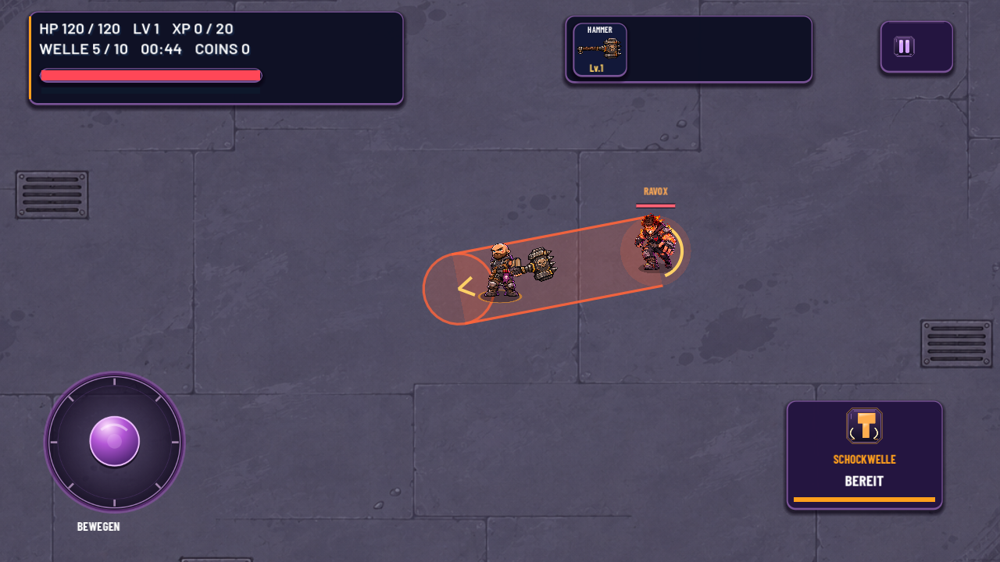

# RF Worlds — Mayhem Survivors 0.13.0 / RAVOX

Ravox – der Wutteufel – als neuer Gegner in beiden Arenen ab Welle 5.

- 140 Basis-HP, Tempo 220, Zermalmer und +15 % Sturmschaden.
- Orange Warnbahn, fixes Ziel, seitlich ausweichen und Erholung nutzen.
- Mit Twinkles Seife/Tornado oder Bruisers Schockwelle unterbrechen.
- Maximal zwei gleichzeitig / vier pro Welle; ersetzt normale Spawns.
- Eigene Grafik, Animation, Sounds, HP-Anzeige und Beute.

[Android-APK 0.13 herunterladen](https://github.com/Whiskymitschuss/Match3/raw/refs/heads/feature/ravox-v0.13/Downloads/MayhemSurvivors-v0.13-debug.apk)

[Vollständiges Quellprojekt ZIP](https://github.com/Whiskymitschuss/Match3/raw/refs/heads/feature/ravox-v0.13/Downloads/MayhemSurvivors-v0.13-source.zip)

1.216 automatisierte Prüfungen und beide historischen Traces bestanden.
Alle vier Helden in beiden Arenen unter begrenzter Last geprüft, keine Android-FPS-Messung.
APK exportiert/signiert. Geräteabnahme und menschliches Ravox-/Twinkle-Balancing offen.
Android 7+, ARM64, offline, Querformat, Code 17, gleicher Paketname/Debug-Schlüssel.
Als Update installieren. Ravox erscheint in Wellen 5–9, kein neuer spielbarer Held.

[Anleitung](MayhemSurvivors/README.md) · [Tests](MayhemSurvivors/TEST_REPORT.md) ·
[Build](MayhemSurvivors/BUILD_REPORT.md) · [Fortschritt](MayhemSurvivors/PROGRESS.md)
