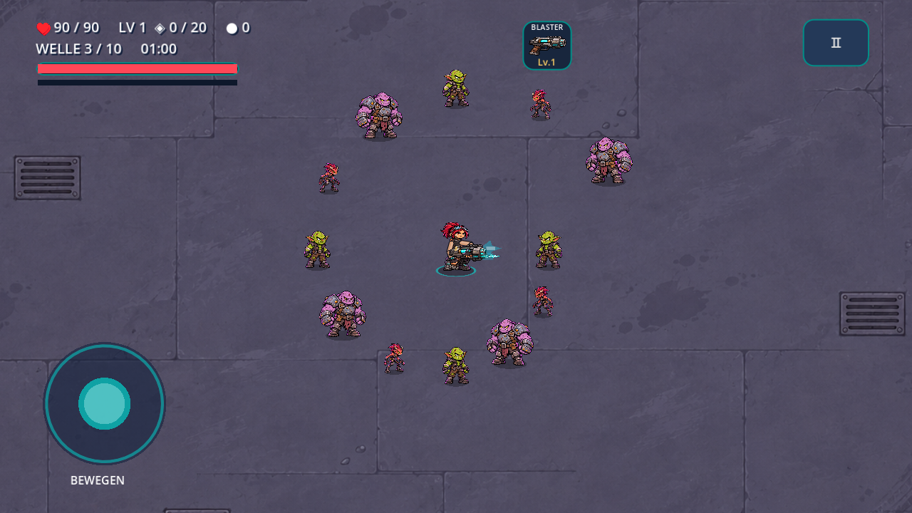

# RF Worlds — Mayhem Survivors 0.2.3

## Gegner, Arena, Bossfeedback und Bestwerte

Grunt, Runner, Tank und THE OVERLORD haben jetzt eigene Comic-Figuren passend zu den Helden.
Die Arena ist ein offener Industriehof mit gezeichnetem Boden und Randmarkierung. Es gibt
keine neuen Hindernisse. Treffer und Tod bekommen eigene Effekte, der Boss warnt mit
phasengetreuen Strahlen oder einem Korridor zum fixierten Sturmziel samt Countdown.
Warnungen besitzen eigene Töne und eine reservierte Audiostimme. Die Siegesfeier ist erweitert.

Die akzeptierte Zwei-Hand-Waffenhaltung und Klassenbindung aus 0.2.2 bleiben unverändert.
Alle Spieldaten, Angriffswerte, Bewegungs-/Kollisionsregeln und Spawnintervalle sind gleich.

## Downloads

- [Android-APK 0.2.3 herunterladen](https://github.com/Whiskymitschuss/Match3/raw/refs/heads/art/world-v0.2.3/Downloads/MayhemSurvivors-v0.2.3-debug.apk)
- [Vollständiges Quellprojekt 0.2.3 als ZIP](https://github.com/Whiskymitschuss/Match3/raw/refs/heads/art/world-v0.2.3/Downloads/MayhemSurvivors-v0.2.3-source.zip)
- [Sturmwarnung ansehen](https://github.com/Whiskymitschuss/Match3/blob/art/world-v0.2.3/MayhemSurvivors/tests/world_boss_charge.png)
- [Radialsalvenwarnung ansehen](https://github.com/Whiskymitschuss/Match3/blob/art/world-v0.2.3/MayhemSurvivors/tests/world_boss_radial.png)

Quell-ZIP ohne APK und Toolchain; die APK ist oben separat verfügbar. Android 7.0+, ARM64,
Querformat, offline. Gleicher Paketname/Signierschlüssel, versionCode 5, als Update vorgesehen.
Keine Berechtigungen angefordert. Echte Geräteinstallation/FPS noch nicht in dieser Umgebung geprüft.

## Neue Statistik

Bestwerte und Bilanz je Held: Spiele, Siege, Kills, Coins, Spielzeit, höchste Welle,
Kill-/Level-/Schadensrekord, längster Run und schnellster Sieg. Die letzten 20 abgeschlossenen
neuen Runden werden mit Waffen gespeichert und lassen sich nach Charakter filtern.

Bisherige Gesamtzahlen/Einstellungen werden aus Format 1 übernommen und vorher unter
`user://save.v1.backup.json` gesichert. Format 2 speichert die neuen Daten. Charakterwerte
und Verlauf beginnen ab 0.2.3; alte Runden werden keinem Charakter nachträglich zugeschrieben.

[Statistikvorschau mit Testdaten](https://github.com/Whiskymitschuss/Match3/blob/art/world-v0.2.3/MayhemSurvivors/tests/world_stats.png) ·
[Charakterbestwerte mit Testdaten](https://github.com/Whiskymitschuss/Match3/blob/art/world-v0.2.3/MayhemSurvivors/tests/world_stats_sparky.png) ·
[Rundenverlauf mit Testdaten](https://github.com/Whiskymitschuss/Match3/blob/art/world-v0.2.3/MayhemSurvivors/tests/world_history.png)

## Geprüft

210 Prüfungen bestanden. Dateimigration mit Originalbackup und Rundendaten getestet.
33 deterministische Kontrollpunkte über 3600 Schritte mit erlaubten Klassen-Loadouts
stimmen mit dem akzeptierten 0.2.2-Stand überein. Kampf-/Klassendaten und die zentralen
Kampfmodule sind bytegleich. Welt, Menge, Rand, Bosswarnungen, Sieg und Statistik tatsächlich
mit Godot/Mesa gerendert. Statistikbilder sind Vorgabedaten, keine ausgelesenen Spielergebnisse.
APK signiert, ARM64 und 16-KiB-Alignment geprüft. Keine Android-Abnahme behauptet.

[Godot-Projekt](MayhemSurvivors) · [Testbericht](MayhemSurvivors/TEST_REPORT.md) ·
[Buildbericht](MayhemSurvivors/BUILD_REPORT.md) · [Entwicklungsstand](MayhemSurvivors/PROGRESS.md)

## Frühere Stände

[0.2.2 Haltung/Klassen](https://github.com/Whiskymitschuss/Match3/tree/fix/character-grips-v0.2.2) ·
[0.2.1 Waffen](https://github.com/Whiskymitschuss/Match3/tree/art/weapons-v0.2.1) ·
[0.2 Charakterbilder](https://github.com/Whiskymitschuss/Match3/tree/art/characters-v0.2) · [0.1 Referenz](https://github.com/Whiskymitschuss/Match3/tree/main)
