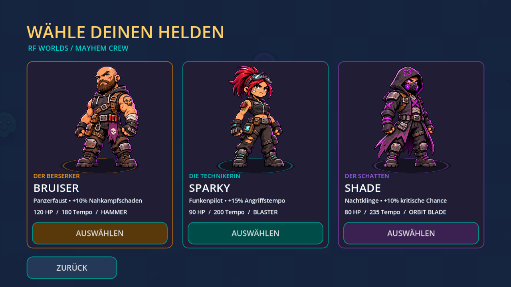

# RF Worlds — Mayhem Survivors

## 0.2 Charaktergrafik-Testversion

Neue Comic-Helden nach den Studioreferenzen: bärtiger Bruiser, rothaarige Sparky und
maskierter Shade. Große Auswahlbilder und vereinfachte Spielfiguren, Laufwippen,
Blickrichtungswechsel und Trefferaufhellung. **Kampf-Balance von 0.1 unverändert.**

- [Android 0.2 APK herunterladen](https://github.com/Whiskymitschuss/Match3/raw/refs/heads/art/characters-v0.2/Downloads/MayhemSurvivors-v0.2-debug.apk)
- [Komplettes 0.2 Projekt als ZIP](https://github.com/Whiskymitschuss/Match3/raw/refs/heads/art/characters-v0.2/Downloads/MayhemSurvivors-v0.2-source.zip)
- [Neue Charakterauswahl ansehen](https://github.com/Whiskymitschuss/Match3/blob/art/characters-v0.2/MayhemSurvivors/tests/characters.png)

Android 7.0 oder neuer, ausschließlich ARM64, Querformat, offline.
Gleicher Paketname und gleiche Debug-Signatur wie 0.1, versionCode 2; als Update vorgesehen.
Echte Updateinstallation, Lesbarkeit im Kampf und Leistung auf Android noch zu prüfen.

## Version 0.1 bleibt verfügbar

- [Bisherige 0.1 APK](https://github.com/Whiskymitschuss/Match3/raw/refs/heads/main/Downloads/MayhemSurvivors-v0.1-debug.apk)
- [Bisheriges 0.1 Quellprojekt](https://github.com/Whiskymitschuss/Match3/tree/main/MayhemSurvivors)

Der Nutzer hat 0.1 über 15 Runden gespielt und die Gegner-/Schussbalance bestätigt.
Der aktuelle Branch verändert deshalb ausschließlich Charakterdarstellung und zugehörige UI.

## Entwicklung und Tests

[MayhemSurvivors](MayhemSurvivors) enthält das vollständige Godot-4.6.3-Projekt.
`MayhemSurvivors/project.godot` öffnen und starten.

76 bestehende Integrationstests erneut bestanden. Die neuen Ansichten wurden mit Godot
Compatibility/Mesa gerendert und geprüft; APK signiert, ARM64 und Alignment verifiziert.
Alle JSON-Spieldaten und die zentralen Kampfsysteme wurden bytegleich gegenüber 0.1 geprüft.
Keine neue Android-Frameratemessung oder vollständige Abnahme auf einem Gerät behauptet.

Details: [Testbericht](MayhemSurvivors/TEST_REPORT.md),
[Buildbericht](MayhemSurvivors/BUILD_REPORT.md),
[Entwicklungsstand](MayhemSurvivors/PROGRESS.md).
