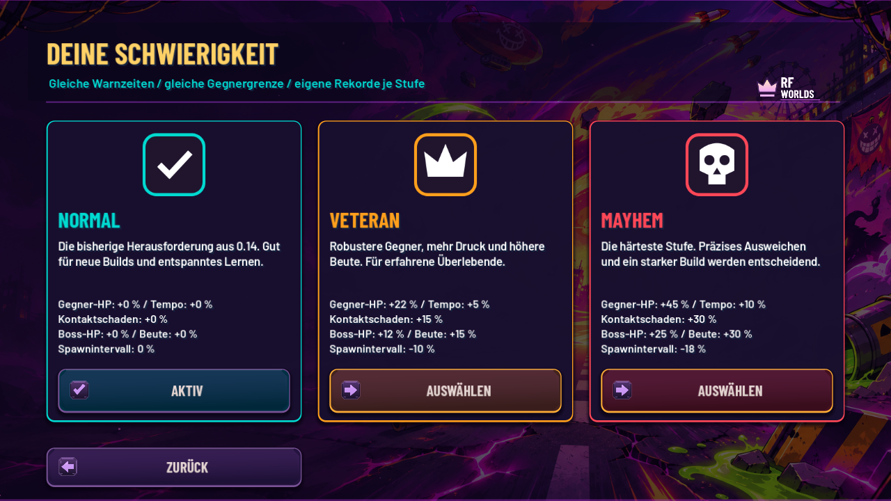

# RF Worlds — Mayhem Survivors 0.15.0

**Normal, Veteran und Mayhem — für Kampagne und Endlos in allen vier Arenen.**

- Normal behält die Spielregeln aus 0.14.
- Veteran/Mayhem mit mehr Gegnerdruck und höherer XP-/Coin-Beute.
- Gleiche Warnzeiten, Gegnergrenze und Charakterwerte.
- Auswahl vor dem Run, Stufe in HUD/Ergebnis/Verlauf, getrennte Stufenrekorde.
- Bestehende Arena-/Endlos-Rekorde werden zu Normal übernommen.

[Android-APK 0.15 herunterladen](https://github.com/Whiskymitschuss/Match3/raw/refs/heads/feature/difficulties-v0.15/Downloads/MayhemSurvivors-v0.15-debug.apk)

[Vollständiges Quellprojekt ZIP](https://github.com/Whiskymitschuss/Match3/raw/refs/heads/feature/difficulties-v0.15/Downloads/MayhemSurvivors-v0.15-source.zip)

1.565 automatisierte Prüfungen und beide historischen Traces bestanden. Lastprobe aller
Stufen in allen Arenen, max100 Gegner. Keine Android-FPS-/Balanceabnahme behauptet.
Android7+, ARM64, offline, Querformat, Code19, gleicher Paketname/Debug-Schlüssel.
Als Update installieren. Arena-Auswahl → SCHWIERIGKEIT; Statistik → STUFEN-REKORDE.

[Anleitung](MayhemSurvivors/README.md) · [Tests](MayhemSurvivors/TEST_REPORT.md) ·
[Build](MayhemSurvivors/BUILD_REPORT.md) · [Fortschritt](MayhemSurvivors/PROGRESS.md)
