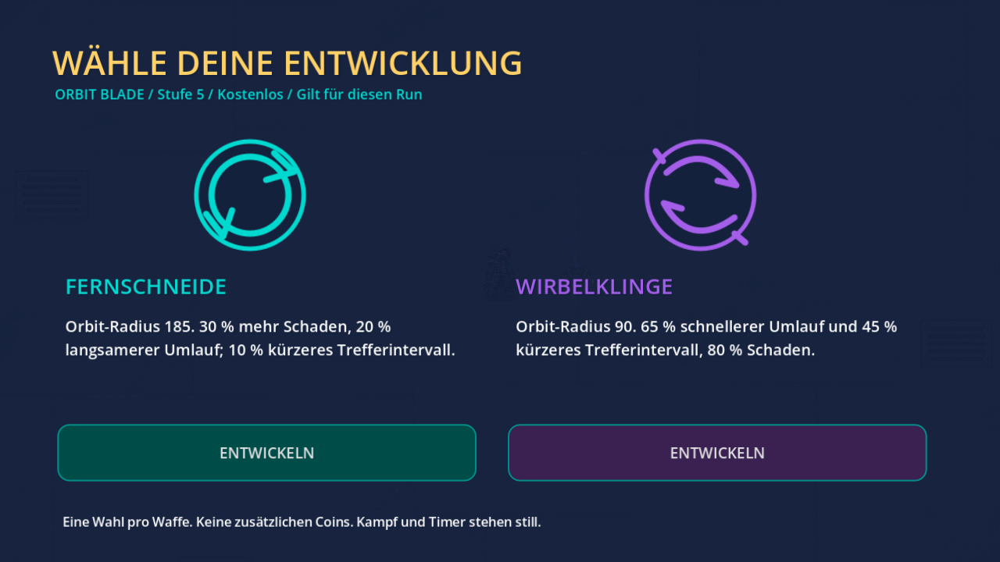

# RF Worlds — Mayhem Survivors 0.5.0

**Zehn Waffenspezialisierungen:** Beim Shopkauf auf Stufe fünf wählst du kostenlos
einen von zwei Wegen. Die Wahl bleibt für diesen Run erhalten.

| Waffe | Weg A | Weg B |
|---|---|---|
| Hammer | Erdbeben | Donnerfaust |
| Blaster | Durchbrecher | Sprengkern |
| Splitgun | Fokusfächer | Schrothagel |
| Arc Cannon | Kettensturm | Hochspannung |
| Orbit Blade | Fernschneide | Wirbelklinge |

- [Android-APK 0.5 herunterladen](https://github.com/Whiskymitschuss/Match3/raw/refs/heads/feature/weapon-specializations-v0.5/Downloads/MayhemSurvivors-v0.5-debug.apk)
- [Vollständiges Quellprojekt ZIP](https://github.com/Whiskymitschuss/Match3/raw/refs/heads/feature/weapon-specializations-v0.5/Downloads/MayhemSurvivors-v0.5-source.zip)
- [Explosion ansehen](MayhemSurvivors/tests/spec_combat_blast.png)

Neue Treffer-/Projektilwirkungen, Orbitgeometrie, Symbole und eigene Synthsounds.
Klassenbindung, Zwei-Hand-Haltung und aktive Fähigkeiten bleiben erhalten.
Ergebnis und Verlauf enthalten die gewählte Entwicklung. Ältere Speicher bleiben kompatibel.
Android 7.0+, ARM64, Querformat, offline. Gleicher Paketname/Signierschlüssel,
versionCode 8: als Update über bestehende App installieren. Nur optionale Vibrationsberechtigung.

551 Assertions bestanden, Referenzvergleich ohne neue Entwicklungen identisch.
Alle zehn Varianten unter Last geprüft. Vollständige Runs und Balancing auf Android
stehen für 0.5 noch aus. Die Fähigkeiten aus 0.4 erhielten positives Nutzer-Praxisfeedback.

[Anleitung](MayhemSurvivors/README.md) · [Testbericht](MayhemSurvivors/TEST_REPORT.md) ·
[Buildbericht](MayhemSurvivors/BUILD_REPORT.md) · [Fortschritt](MayhemSurvivors/PROGRESS.md)
