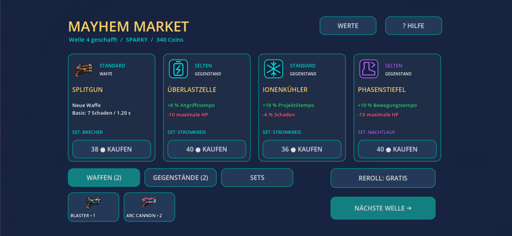

# RF Worlds — Mayhem Survivors 0.7.0

**Neuer Shop, Vollbild und anspruchsvollere Wellen ab Welle vier in beiden Arenen.**

- Vier Angebotskarten, Werteübersicht und antippbare Ausrüstung.
- Acht Gegenstände mit Vor-/Nachteilen und drei Set-Boni.
- Waffen aufrüsten, Details ansehen und mit Bestätigung verwerten; letzte Waffe geschützt.
- Kurze Shop-Hilfe, gratis erster Reroll; keine Werbung/VIP/Bezahlfunktionen.
- Breites Vollbild mit Safe-Area-Steuerung; Schrottplatz/Reaktor ab Welle vier verstärkt.

[Android-APK 0.7 herunterladen](https://github.com/Whiskymitschuss/Match3/raw/refs/heads/feature/shop-fullscreen-v0.7/Downloads/MayhemSurvivors-v0.7-debug.apk)

[Vollständiges Godot-Quellprojekt als ZIP](https://github.com/Whiskymitschuss/Match3/raw/refs/heads/feature/shop-fullscreen-v0.7/Downloads/MayhemSurvivors-v0.7-source.zip)

Android 7.0+, ARM64, Querformat, offline. Gleicher Paketname und Signierschlüssel,
VersionCode 11: als Update installieren, lokale Statistik bleibt erhalten.
798 automatisierte Assertions bestanden; zusätzlich Last-/Bossproben und echte
Godot-Renderprüfung. Android-Hardwareabnahme der neuen Version noch offen.

[Anleitung](MayhemSurvivors/README.md) · [Testbericht](MayhemSurvivors/TEST_REPORT.md) ·
[Buildbericht](MayhemSurvivors/BUILD_REPORT.md) · [Fortschritt](MayhemSurvivors/PROGRESS.md)
