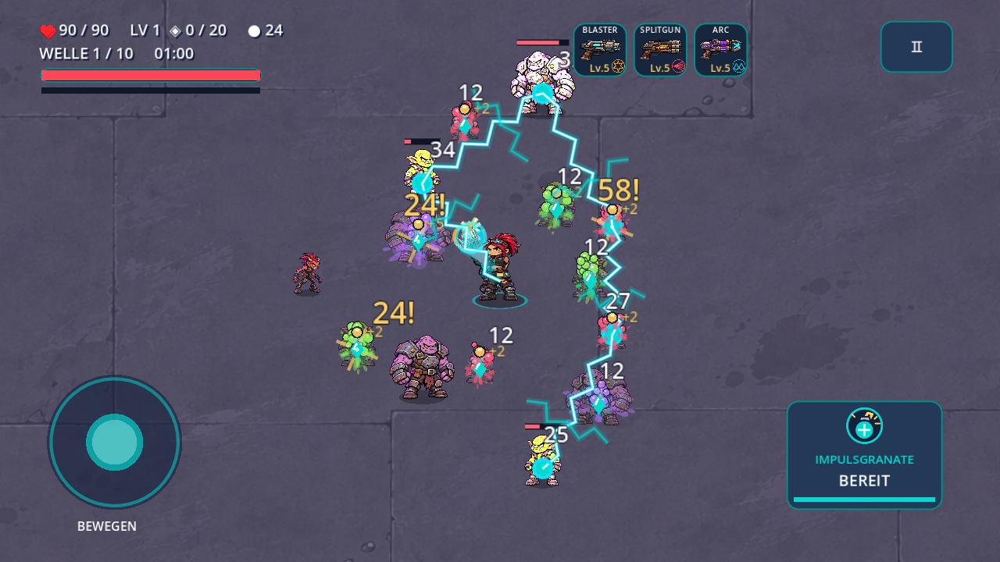

# RF Worlds — Mayhem Survivors 0.5.1

**Effektpaket vor dem nächsten Handy-Test:** Cartoon-Splatter, ausblendende Bodenspuren,
Mündungsblitze, Geschossspuren, Funken/Rauch, Hammerrisse, elektrische Entladungen,
Explosionen und Schatten-Nachbilder. Dazu kleine Münz-Popups statt alter Todesringe.

- [Android-APK 0.5.1 herunterladen](https://github.com/Whiskymitschuss/Match3/raw/refs/heads/art/combat-effects-v0.5.1/Downloads/MayhemSurvivors-v0.5.1-debug.apk)
- [Vollständiges Quellprojekt ZIP](https://github.com/Whiskymitschuss/Match3/raw/refs/heads/art/combat-effects-v0.5.1/Downloads/MayhemSurvivors-v0.5.1-source.zip)
- [Bodenspuren](MayhemSurvivors/tests/fx_floor_stains.png) · [Schattenschritt](MayhemSurvivors/tests/fx_shadow_step.png)

Enthält alle zehn Waffenentwicklungen aus 0.5 und Fähigkeiten aus 0.4. Klassenbindung,
Kampfwerte und Belohnungen erhalten. Neuer Splatter-Schalter, Qualitätslimits und eigener
visueller RNG. Android 7.0+, ARM64, Querformat, offline. Gleicher Paketname/Signierschlüssel,
versionCode 9: als Update über bestehende App installieren. Nur optionale Vibrationsberechtigung.

591 Assertions bestanden. Neuer Gameplayvergleich mit 0.5 über 174 Kontrollpunkte / 17.400
Schritte für alle Waffenwege, Fähigkeiten, Arenen und Bosse identisch, auch LOW/Splatter AUS.
Effektlimits unter Last getestet; keine tatsächliche Geräte-FPS-Messung oder Android-Abnahme.

[Anleitung](MayhemSurvivors/README.md) · [Testbericht](MayhemSurvivors/TEST_REPORT.md) ·
[Buildbericht](MayhemSurvivors/BUILD_REPORT.md) · [Fortschritt](MayhemSurvivors/PROGRESS.md)
