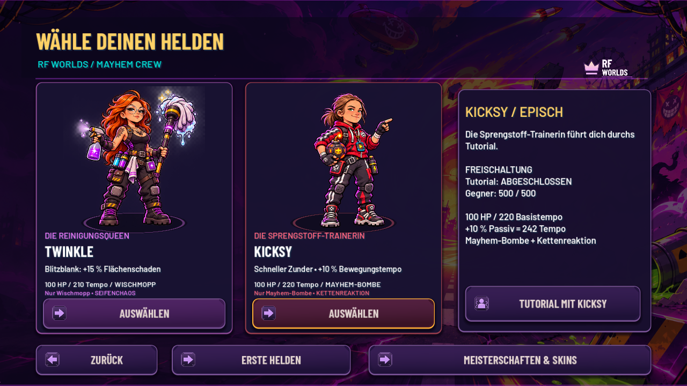

# RF Worlds — Mayhem Survivors 0.14.0

**Vier Arenen, Endlosmodus und Kicksy als Coach und freischaltbare Heldin.**

- Neu: Neonhafen und Glutwerk mit eigenen Bossgrafiken und Gefahren.
- Endlos: Bosse alle zehn Wellen, danach Shop und weiter, eigene Arena-Rekorde.
- Stetig steigende Schwierigkeit, schnelleres und vorausschauendes Gegnerverhalten.
- 13 interaktive Tutorial-Etappen mit Kicksy; Freischaltung: Tutorial + 500 Gegner.
- Eigene Mayhem-Bombe, Kettenreaktion, zwei Entwicklungen und fünf Helden insgesamt.
- Überarbeitete Menüs mit Verläufen, Sensor-Parallaxe, Kalibrierung und ruhiger Darstellung.

[Android-APK 0.14 herunterladen](https://github.com/Whiskymitschuss/Match3/raw/refs/heads/feature/worlds-endless-v0.14/Downloads/MayhemSurvivors-v0.14-debug.apk)

[Vollständiges Quellprojekt ZIP](https://github.com/Whiskymitschuss/Match3/raw/refs/heads/feature/worlds-endless-v0.14/Downloads/MayhemSurvivors-v0.14-source.zip)

[Neue Arenen](MayhemSurvivors/tests/worlds_arenas.png) ·
[Kicksy-Coach](MayhemSurvivors/tests/worlds_tutorial_intro.png) ·
[Endlos-Welle20 im Glutwerk](MayhemSurvivors/tests/worlds_foundry.png)

1.513 automatisierte Prüfungen und zwei historische Traces bestanden. Traces frieren
alte Schwierigkeit ein; aktuelle Progression besitzt eigene Tests. Lastprobe: alle fünf
Helden in vier Arenen, maximal 100 Gegner. Keine Android-FPS-/Sensor-Abnahme behauptet.
Android 7+, ARM64, offline, Landscape, Code 18, gleicher Paketname und Debug-Schlüssel.
Als Update installieren. TUTORIAL MIT KICKSY / Arena-Auswahl → WEITERE ARENEN und MODUS.

[Anleitung](MayhemSurvivors/README.md) · [Tests](MayhemSurvivors/TEST_REPORT.md) ·
[Build](MayhemSurvivors/BUILD_REPORT.md) · [Fortschritt](MayhemSurvivors/PROGRESS.md)
