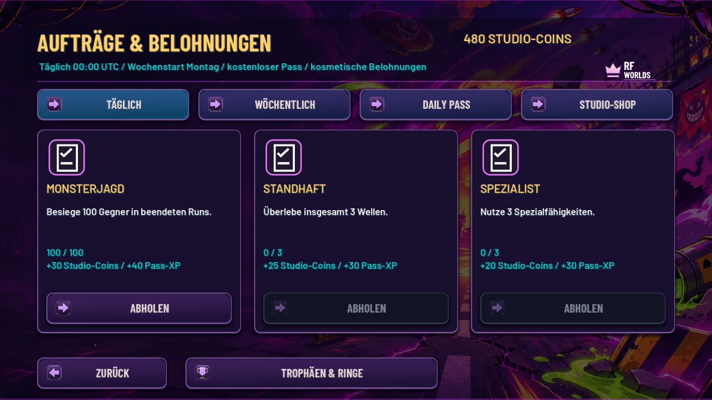
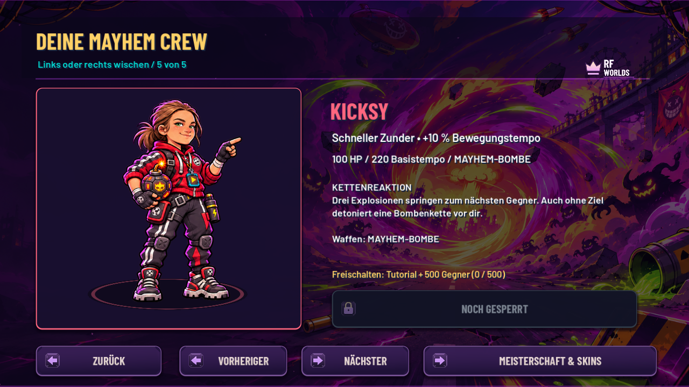

# RF Worlds — Mayhem Survivors 0.16.0

**Wische durch deine Crew. Überstehe neue Gefahren. Verdiene dauerhafte Belohnungen.**

- Helden und Arenen mit Wischgesten wählen; große Einzelkarten und Pfeilalternative.
- Drei neue Gegner: Bombling, Longshot, Hexling mit angekündigten Angriffen.
- Ereignisse in allen vier Arenen ab Welle3.
- Tages-/Wochenaufgaben und kostenloser wiederholbarer Daily Pass.
- Dauerhafte Studio-Coins für Ringe, Begleiter und Spielertitel im Studio-Shop.
- Offline, lokal gespeichert, keine Werbung/In-App-Käufe.

[Android-APK 0.16 herunterladen](https://github.com/Whiskymitschuss/Match3/raw/refs/heads/feature/live-rewards-v0.16/Downloads/MayhemSurvivors-v0.16-debug.apk)

[Vollständiges Godot-Quellprojekt ZIP](https://github.com/Whiskymitschuss/Match3/raw/refs/heads/feature/live-rewards-v0.16/Downloads/MayhemSurvivors-v0.16-source.zip)

Android7+, ARM64, Querformat, Code20, gleicher Paketname/Debug-Schlüssel. Als Update
installieren. AUFTRÄGE & SHOP im Hauptmenü: Nach Run-Ende Fortschritt prüfen, Belohnung
abholen und im Studio-Shop ausgeben. Run-Coins bleiben für den Waffenladen.
Kalender anhand Geräte-UTC, täglicher Wechsel00:00, WochenwechselMontag. Pass verfällt nicht.

22 Suites / 1.644 Assertions, zwei historische Traces und Lastprobe mit21.600 Schritten.
APK exportiert, Signatur/Alignment/ARM64/Payload geprüft. Physischer Android-Test von
Wischbedienung, neuer Balance und FPS/Thermik offen; Screenshots stammen aus nativer Engine.

[Anleitung](MayhemSurvivors/README.md) · [Tests](MayhemSurvivors/TEST_REPORT.md) ·
[Build](MayhemSurvivors/BUILD_REPORT.md) · [Fortschritt](MayhemSurvivors/PROGRESS.md)
