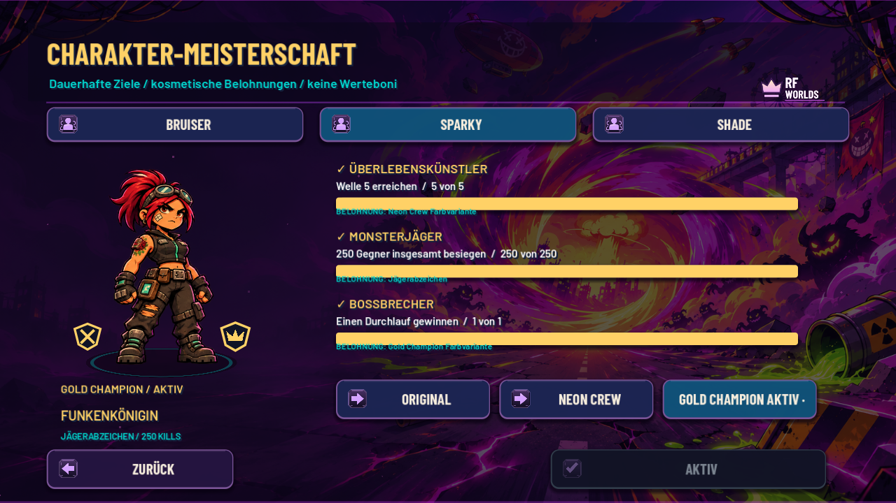

# RF Worlds — Mayhem Survivors 0.11.0

Charakter-Meisterschaften: eigene Ziele, kosmetische Farbvarianten und Meistertitel.

- Je Held Welle 5 erreichen, 250 Gegner besiegen und einen Run gewinnen.
- Neon Crew, Gold Champion, Jägerabzeichen und drei individuelle Titel freischalten.
- Vorschau und dauerhafte Auswahl unter CHARAKTERE → MEISTERSCHAFTEN & SKINS.
- Bereits vorhandene Charakterrekorde zählen mit. Keine Änderungen an Kampfwerten.

[Android-APK 0.11 herunterladen](https://github.com/Whiskymitschuss/Match3/raw/refs/heads/feature/character-mastery-v0.11/Downloads/MayhemSurvivors-v0.11-debug.apk)

[Vollständiges Quellprojekt ZIP](https://github.com/Whiskymitschuss/Match3/raw/refs/heads/feature/character-mastery-v0.11/Downloads/MayhemSurvivors-v0.11-source.zip)

1.075 automatisierte Prüfungen und beide historischen Traces bestanden.
Android-APK exportiert/signiert. Neue Geräteabnahme noch offen.
Android 7+, ARM64, offline, Querformat, gleicher Paketname/Schlüssel, Code 15.
Als Update installieren; Fortschritt und Einstellungen bleiben erhalten.

[Anleitung](MayhemSurvivors/README.md) · [Tests](MayhemSurvivors/TEST_REPORT.md) ·
[Build](MayhemSurvivors/BUILD_REPORT.md) · [Fortschritt](MayhemSurvivors/PROGRESS.md)
