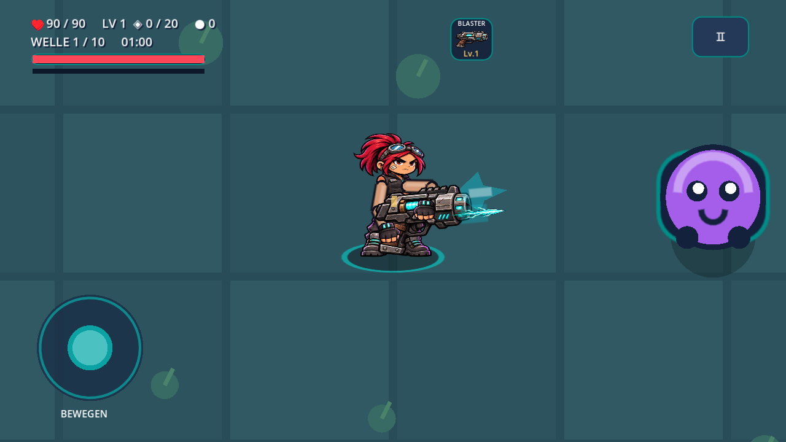

# Mayhem Survivors — RF Worlds — 0.2.2 Teststand

## Zwei Hände statt gestapelter Waffen

Die Spielfigur ist jetzt aus einem Körper ohne eingemalte Arme, zwei Armketten und zwei
Handschuhkomponenten aufgebaut. Genau diese zwei Hände liegen an den Griffpunkten der
sichtbar gehaltenen Hauptwaffe. Auch mit mehreren Schusswaffen gibt es keine zusätzlichen
Hände oder gehaltenen Waffen. Orbit Blade bleibt frei schwebend.

## Vorläufige Waffenbindung

| Held | Erlaubte Waffen |
|---|---|
| Bruiser | Hammer |
| Sparky | Blaster, Splitgun, Arc Cannon |
| Shade | Orbit Blade |

Die Bindung war der vorgeschlagene Teststand; eine abweichende Auswahl im Chat kann noch
berücksichtigt werden. Shop und Kaufprüfung erzwingen dieselben Klassenregeln. Stat-Upgrades
vergeben keine fremden Waffen; reine Nah-/Orbitklassen erhalten keine nutzlosen Projektil-Upgrades.
Sparky kann passende Schusswaffen kombinieren; nur eine wird mit den Händen geführt.

**Schadenswerte und Feuerraten bleiben gleich, die möglichen Builds ändern sich.**
Die neue Klassenbalance über volle zehn Wellen ist noch zu prüfen.

## Downloads

- [Android-APK 0.2.2](https://github.com/Whiskymitschuss/Match3/raw/refs/heads/fix/character-grips-v0.2.2/Downloads/MayhemSurvivors-v0.2.2-debug.apk)
- [Komplettes Projekt 0.2.2 als ZIP](https://github.com/Whiskymitschuss/Match3/raw/refs/heads/fix/character-grips-v0.2.2/Downloads/MayhemSurvivors-v0.2.2-source.zip)
- [Haltung in normaler Spielgröße](https://github.com/Whiskymitschuss/Match3/blob/fix/character-grips-v0.2.2/MayhemSurvivors/tests/grip_sparky_all.png)
- [Charakterwahl und Spezialisierungen](https://github.com/Whiskymitschuss/Match3/blob/fix/character-grips-v0.2.2/MayhemSurvivors/tests/grip_characters.png)

Android 7.0 oder neuer, ARM64, Querformat, offline. Gleicher Paketname und Signierschlüssel,
versionCode 4; als Update vorgesehen. Geräteinstallation und neue Klassenbalance noch offen.

## Tatsächlich geprüft

146 Prüfungen bestanden: 76 bestehende, 28 Effekte, 42 Klassen-/Haltungsprüfungen.
33 historische Kontrollpunkte über 3600 Simulationsschritte prüfen weiterhin
die unveränderten Schadensformeln mit künstlich injizierten alten Loadouts. Dies ist kein
Nachweis der neuen Klassenbalance. Normale Ansichten und vergrößerte Griffbilder wurden
mit Godot/Mesa gerendert und geprüft. APK-Signatur, ARM64 und Alignment verifiziert.
Keine neue Android-FPS-Messung oder vollständige Abnahme auf echter Hardware behauptet.

[Godot-Projekt](MayhemSurvivors) · [Testbericht](MayhemSurvivors/TEST_REPORT.md) ·
[Buildbericht](MayhemSurvivors/BUILD_REPORT.md) · [Entwicklungsstand](MayhemSurvivors/PROGRESS.md)

## Frühere Stände

[0.2.1 Waffenupdate](https://github.com/Whiskymitschuss/Match3/tree/art/weapons-v0.2.1) ·
[0.2 Charakterbilder](https://github.com/Whiskymitschuss/Match3/tree/art/characters-v0.2) · [0.1 Referenz](https://github.com/Whiskymitschuss/Match3/tree/main)
