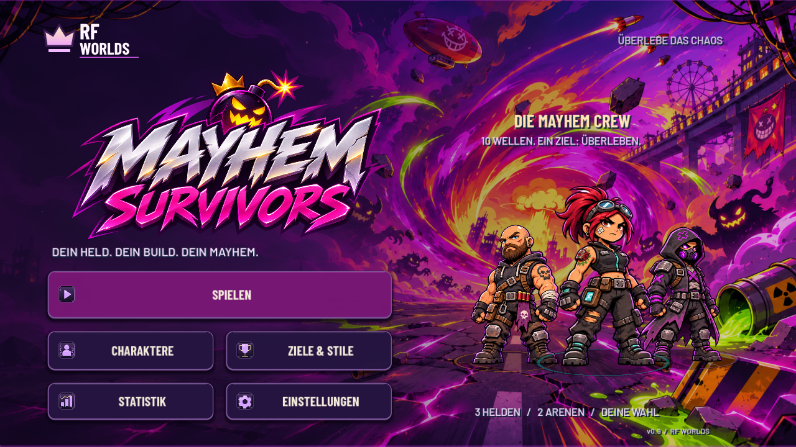

# RF Worlds — Mayhem Survivors 0.9.0

**Neon-Comic-Menürework: fertige Grafiken, konsistente Menüs und leichte Animationen.**

Neue Weltillustration, kompakte Wortmarke, MS-App-Icon und Studiomarke. 49 semantische
UI-Icons ersetzen Textsymbole; Item-/Fähigkeits-/Entwicklungsicons und Joystick erneuert.
Gemeinsame Karten/Buttonzustände, Lesbarkeit und Ergebnisumbruch verbessert.
Kurze Einblend-/Positionsübergänge, dezentes Leuchten und Hintergrund-Weichzeichner;
LOW deaktiviert die neuen Bewegungseffekte. Bestätigte Balance, Offlinebetrieb und Audiopaket erhalten.

[Android-APK 0.9 herunterladen](https://github.com/Whiskymitschuss/Match3/raw/refs/heads/feature/neon-interface-v0.9/Downloads/MayhemSurvivors-v0.9-debug.apk)

[Vollständiges Godot-Projekt ZIP](https://github.com/Whiskymitschuss/Match3/raw/refs/heads/feature/neon-interface-v0.9/Downloads/MayhemSurvivors-v0.9-source.zip)

[Animierte Menüvorschau — Engine-Mitschnitt](https://github.com/Whiskymitschuss/Match3/raw/refs/heads/feature/neon-interface-v0.9/MayhemSurvivors/tests/menu_motion_preview.gif)

Android 7.0+, ARM64, Querformat, offline. Code 13, gleiche Signatur/Paket:
als Update installieren, lokale Statistik/Einstellungen erhalten.
926 Assertions und beide Kampftraces bestanden. Neue Android-Hardwareabnahme offen.

[Anleitung](MayhemSurvivors/README.md) · [Tests](MayhemSurvivors/TEST_REPORT.md) ·
[Build](MayhemSurvivors/BUILD_REPORT.md) · [Fortschritt](MayhemSurvivors/PROGRESS.md) ·
[Quellen](MayhemSurvivors/CREDITS.md)
