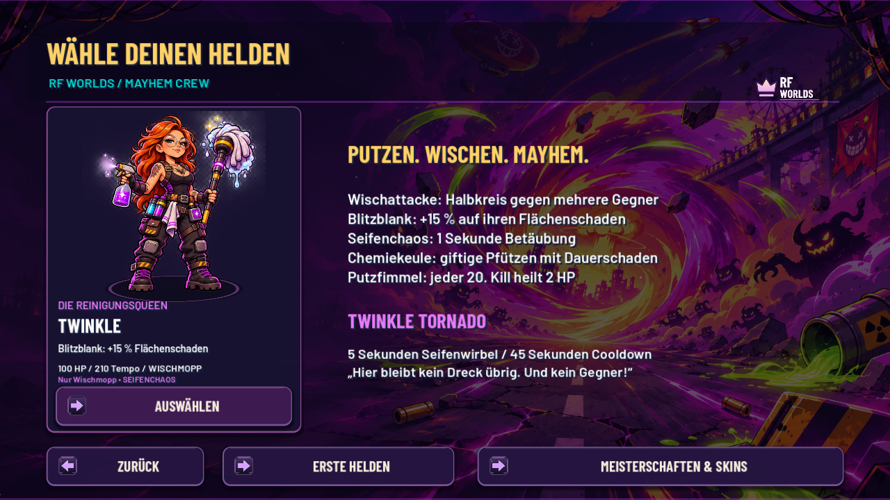

# RF Worlds — Mayhem Survivors 0.12.0 / TWINKLE

Die Reinigungsqueen ist als vierte Heldin spielbar: 100 HP, Tempo 210, nur Wischmopp.

- Halbkreis-Moppattacke und +15 % Flächenschaden.
- Seifenbetäubung, Giftpfützen und 2 HP Heilung bei jedem 20. Kill.
- Fünf Sekunden TWINKLE TORNADO, 45 Sekunden Cooldown.
- Eigene Grafik, Mopp/Sprühflasche, Sounds, Effekte und zwei Waffenentwicklungen.
- Vollständig in Shop, Statistik, Meisterschaften und lokale Speicherung eingebunden.

[Android-APK 0.12 herunterladen](https://github.com/Whiskymitschuss/Match3/raw/refs/heads/feature/twinkle-v0.12/Downloads/MayhemSurvivors-v0.12-debug.apk)

[Vollständiges Quellprojekt ZIP](https://github.com/Whiskymitschuss/Match3/raw/refs/heads/feature/twinkle-v0.12/Downloads/MayhemSurvivors-v0.12-source.zip)

[Twinkle Tornado](MayhemSurvivors/tests/twinkle_tornado.png) ·
[Waffenentwicklungen](MayhemSurvivors/tests/twinkle_evolution.png)

1.164 automatisierte Prüfungen und beide historischen Traces bestanden.
APK exportiert/signiert. Android-Geräteabnahme und menschliches Twinkle-Balancing offen.
Android 7+, ARM64, offline, Querformat, Code 16, gleicher Paketname/Debug-Schlüssel.
Als Update installieren. CHARAKTERE → WEITERE HELDEN → TWINKLE.

[Anleitung](MayhemSurvivors/README.md) · [Tests](MayhemSurvivors/TEST_REPORT.md) ·
[Build](MayhemSurvivors/BUILD_REPORT.md) · [Fortschritt](MayhemSurvivors/PROGRESS.md)
