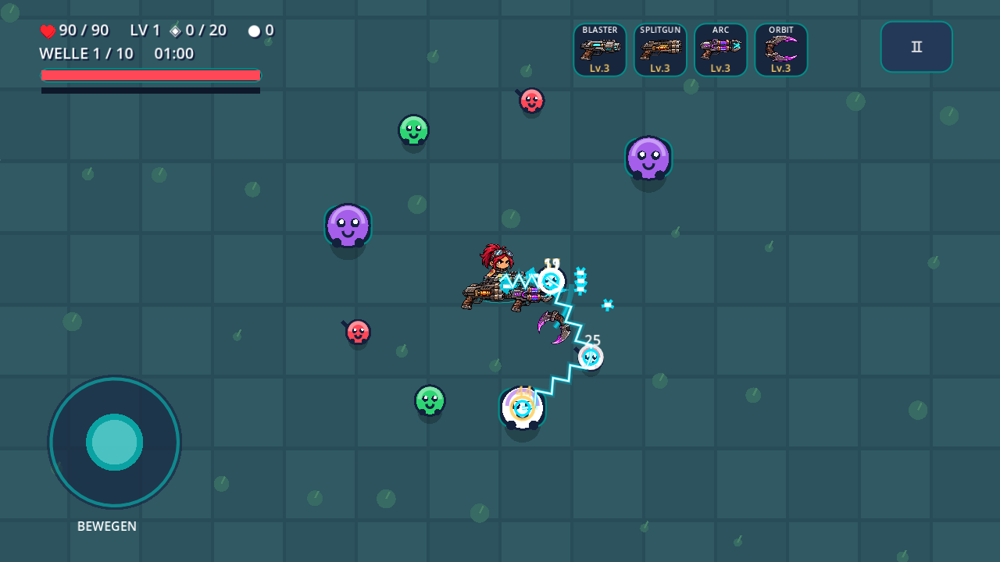

# RF Worlds — Mayhem Survivors 0.2.1

## Echte Waffen und eigene Geschosse

Alle fünf Waffen haben jetzt Comic-Grafiken passend zu den Helden: Blaster, Kriegshammer,
Splitgun, Arc Cannon und Orbit Blade. Keine Waffen-Rechtecke oder einfachen Balken mehr.
Automatische Ausrichtung, Rückstoß, Mündungsfeuer, Hammerschwung, Bodenschock,
Kettenblitz, Klingenspur, Trefferfunken, Hülsen und fünf eigene Waffensounds sind verbunden.
Waffenbilder erscheinen auch in Shop und HUD.

Die Geschossform richtet sich nach dem Charakter:
**Bruiser: Goldgeschoss / Sparky: türkise Plasmalanze / Shade: violetter Energiedorn.**
Bossgeschosse sind rot-orange. Die Waffenmechanik und Balance bleiben erhalten.

- [Android 0.2.1 APK herunterladen](https://github.com/Whiskymitschuss/Match3/raw/refs/heads/art/weapons-v0.2.1/Downloads/MayhemSurvivors-v0.2.1-debug.apk)
- [Komplettes Projekt 0.2.1 als ZIP](https://github.com/Whiskymitschuss/Match3/raw/refs/heads/art/weapons-v0.2.1/Downloads/MayhemSurvivors-v0.2.1-source.zip)
- [Waffen und Kettenblitz im Kampf ansehen](https://github.com/Whiskymitschuss/Match3/blob/art/weapons-v0.2.1/MayhemSurvivors/tests/combat_sparky.png)
- [Waffen im Shop ansehen](https://github.com/Whiskymitschuss/Match3/blob/art/weapons-v0.2.1/MayhemSurvivors/tests/combat_shop.png)

Android 7.0 oder neuer, ausschließlich ARM64, Querformat, offline. Gleicher Paketname und
Signierschlüssel wie bisher; versionCode 3, als Update vorgesehen. Grafik, Sound und Update
auf dem physischen Android-Gerät müssen noch praktisch geprüft werden.

## Geprüft

76 bisherige Tests plus 28 neue Tests bestanden. Drei Helden über 3600 Simulationsschritte
mit der Version 0.1 verglichen: HP, XP, Coins, Kills, Schaden, Gegner, Geschosse und Krit-Zufall
stimmen an 33 Kontrollpunkten überein. Alle Spiel-JSON-Dateien sind unverändert.
120 simulierte Sekunden Belastungstest bestanden. Neue Ansichten mit Godot gerendert.
APK signiert, ARM64, Berechtigungen und 16-KiB-Alignment geprüft.
Keine neue Geräte-Frameratemessung oder Android-Abnahme behauptet.

## Frühere Versionen

- [0.2 Charaktergrafik-Testversion](https://github.com/Whiskymitschuss/Match3/tree/art/characters-v0.2)
- [0.1 Referenzversion](https://github.com/Whiskymitschuss/Match3/tree/main)

Der Nutzer hat nach 15 Runden die Gegner-/Schussbalance bestätigt. Deshalb wurden für
diese Updates keine Schadenswerte, Feuerraten, Kollisionsregeln oder Spawns angepasst.

[Godot-Projekt](MayhemSurvivors) · [Testbericht](MayhemSurvivors/TEST_REPORT.md) ·
[Buildbericht](MayhemSurvivors/BUILD_REPORT.md) · [Entwicklungsstand](MayhemSurvivors/PROGRESS.md)
