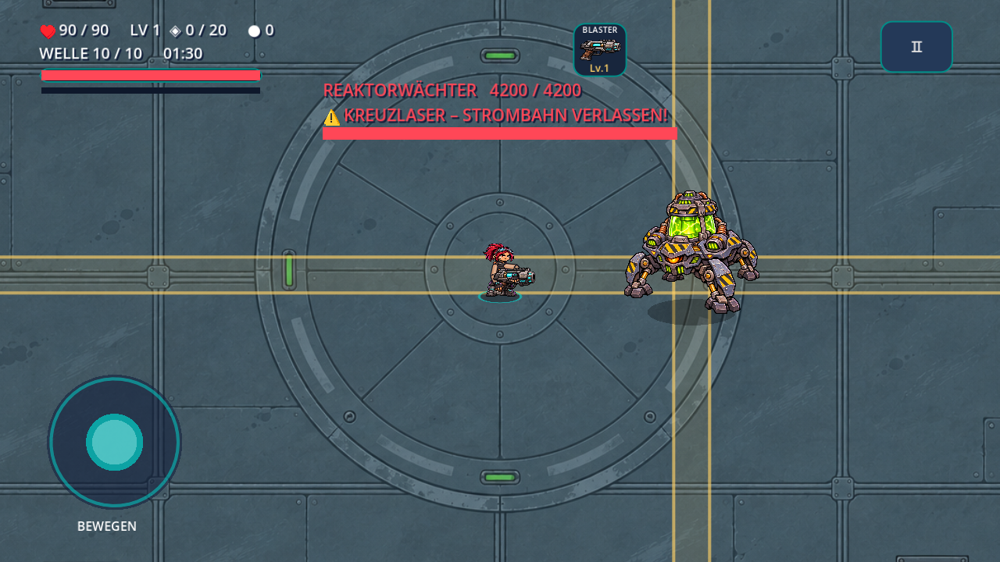

# RF Worlds — Mayhem Survivors 0.3.0

Arena-Auswahl, freischaltbare **Reaktorzone** und ein eigener **Reaktorwächter** mit
Kreuzlasern, Kernbomben und gerichteten Salven. Zehn Wellen, Shop und Klassenwaffen.
Der Schrottplatz behält seine bestätigten Kampfwerte.

- [Android-APK 0.3 herunterladen](https://github.com/Whiskymitschuss/Match3/raw/refs/heads/feature/reactor-v0.3/Downloads/MayhemSurvivors-v0.3-debug.apk)
- [Vollständiges Quellprojekt als ZIP](https://github.com/Whiskymitschuss/Match3/raw/refs/heads/feature/reactor-v0.3/Downloads/MayhemSurvivors-v0.3-source.zip)
- [Arena-Auswahl ansehen](MayhemSurvivors/tests/reactor_selection.png)

Als Update über die bisherige App installieren: gleicher Paketname/Schlüssel,
versionCode 6. Android 7.0+, ARM64, Querformat, offline, keine Berechtigungen.
Ein erster Sieg schaltet die Reaktorzone frei; vorhandene Siege zählen mit.
Neue Arena-Statistiken und erspielbare kosmetische Ringe unter „Ziele & Stile“.
Alte Speicherformate werden mit Originalbackup übernommen.

367 Assertions und der deterministische Schrottplatzvergleich bestanden. Zwei
Belastungsläufe und gerenderte UI-Prüfung ausgeführt. Physische Android-Abnahme
der neuen Reaktorzone und Geräte-FPS stehen aus.

[Projekt/Anleitung](MayhemSurvivors/README.md) · [Testbericht](MayhemSurvivors/TEST_REPORT.md) ·
[Buildbericht](MayhemSurvivors/BUILD_REPORT.md) · [Fortschritt](MayhemSurvivors/PROGRESS.md)

Der bestätigte ältere Stand bleibt als Tag `v0.2.3-reference` erhalten.
