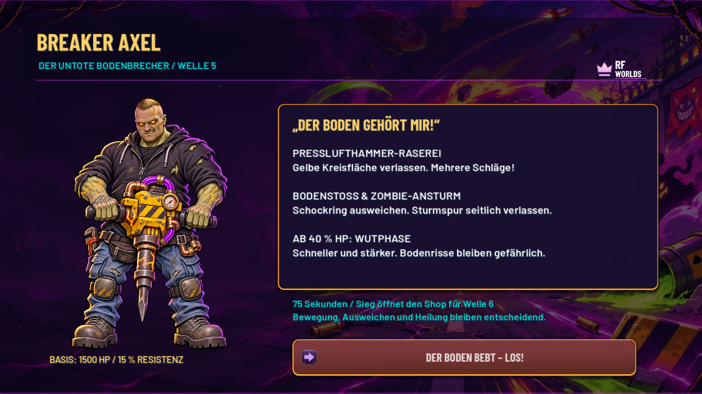
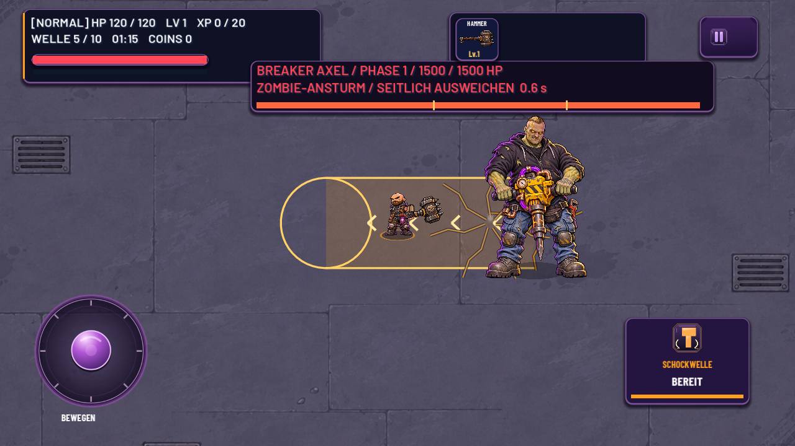
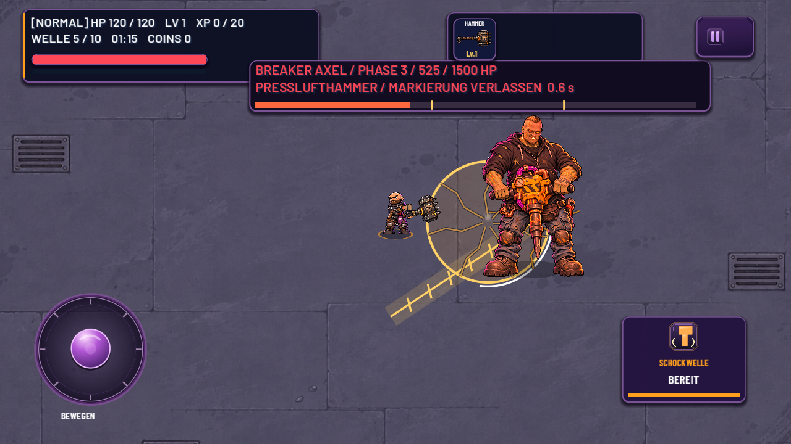

# RF Worlds — Mayhem Survivors0.19.0 / BREAKER AXEL

Neuer Untoten-Boss in Welle5 aller vier Arenen: eigene Cartoon-Grafik, mutierter
Presslufthammer, Schockringe, Hammerraserei, Ansturm und Wutphase unter40% Leben.
Zehnwelliger Run bleibt: Axel-Sieg → Levelwahl → Shop → Welle6 → Arenaboss in10.
Endlos:Axel in5/15/25/... . Garage/Cases und dauerhafte Sammlung aus0.18 erhalten.

[Android-APK0.19 herunterladen](https://github.com/Whiskymitschuss/Match3/raw/refs/heads/feature/breaker-axel-v0.19/Downloads/MayhemSurvivors-v0.19-debug.apk)

[Vollständiges Godot-Quellprojekt ZIP](https://github.com/Whiskymitschuss/Match3/raw/refs/heads/feature/breaker-axel-v0.19/Downloads/MayhemSurvivors-v0.19-source.zip)

[SHA256-Prüfsummen](https://github.com/Whiskymitschuss/Match3/raw/refs/heads/feature/breaker-axel-v0.19/Downloads/SHA256SUMS-v0.19.txt)

Als Update über0.18 installieren. Im normalen Run Welle4 überleben und im Shop
fortsetzen; danach erscheint Axels Vorstellung. Kein neues Profil erforderlich.
26 Testsuiten /2.144 Prüfungen und beide historischen Vergleichsläufe bestanden.
Signatur/Alignment/Manifest/Payload werden im BUILD_REPORT protokolliert.
Physischer Android-/Touch-/FPS-/Balancetest bleibt offen. Weltkarte/Arenenfreigabe
ist der nächste separate Inhaltsumfang.

Godot: [Projektanleitung](MayhemSurvivors/README.md) / [Tests](MayhemSurvivors/TEST_REPORT.md) /
[Fortschritt](MayhemSurvivors/PROGRESS.md). Quellarchiv enthält alle Laufzeitressourcen,
Szenen, Skripte, Daten, Tests und Berichte; ohne SDK/Importcache/private Schlüssel.
