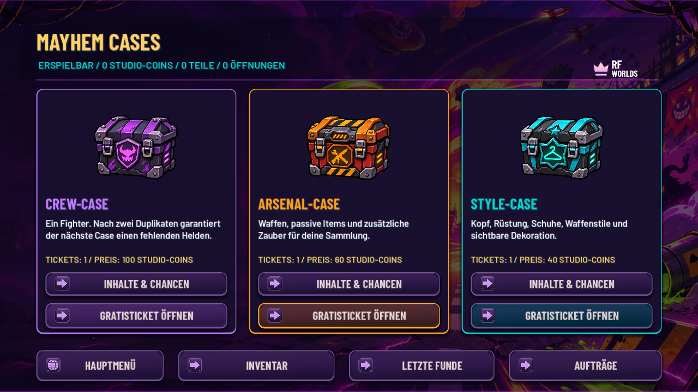
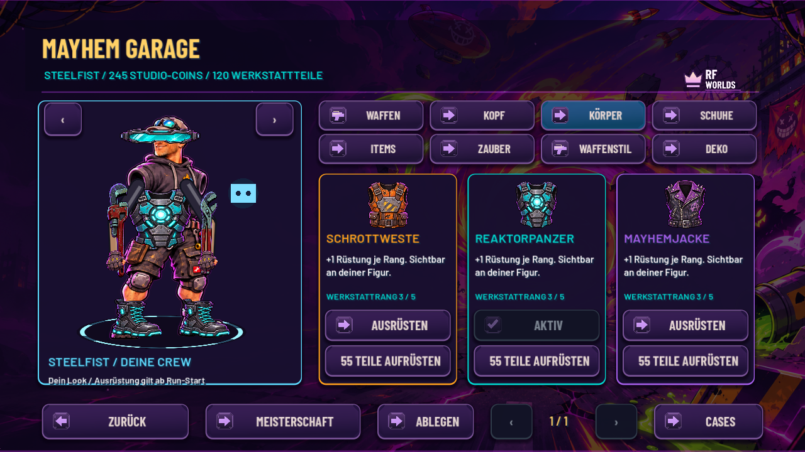

# RF Worlds — Mayhem Survivors0.18.0 / MAYHEM GARAGE

**Cases öffnen, Fighter freischalten und deinen eigenen Look ausrüsten.**

- Nur Bruiser frei; fünf weitere Fighter über Crew-Cases.
- Crew-, Arsenal- und Style-Case, je1 kostenloses Startticket, echte Chancen und Garantie.
-32 Sammlungseinträge, Duplikatteile, Werkstattränge1–5 und persönliche Ausrüstung.
- Sichtbare Kopf-/Körper-/Schuhteile, Waffenstile und Dekoration.
- Drei zusätzliche aktive Zauber mit separatem Touch-Button.
- Studio-Coins aus echten Runs sowie bisherigen Aufgaben und kostenlosem Pass.
- Offline, lokal gespeichert, keine Werbung oder Echtgeldkäufe.

[Android-APK0.18 herunterladen](https://github.com/Whiskymitschuss/Match3/raw/refs/heads/feature/mayhem-garage-v0.18/Downloads/MayhemSurvivors-v0.18-debug.apk)

[Vollständiges Godot-Quellprojekt ZIP](https://github.com/Whiskymitschuss/Match3/raw/refs/heads/feature/mayhem-garage-v0.18/Downloads/MayhemSurvivors-v0.18-source.zip)

Hauptmenü → CASES & GARAGE; Charakterauswahl → INVENTAR & STILE. Als Update installieren:
Android7+, ARM64, Querformat, Code22, gleicher Paketname/Debug-Schlüssel. Stats/Coins/Deko
bleiben erhalten; alte Gratis-Fighter werden entsprechend der neuen Regel per Case erspielt.

25 Suites /1.898 Assertions, beide historische Traces,86.400 Lastschritte und15 native
Ansichten geprüft. APK-Signatur/Alignment/ARM64/Payload geprüft. Echte Android-Abnahme
von Bedienung, Update und neuer Balance offen. Lineare Weltenfreigabe folgt separat.

[Garage-Anleitung](MayhemSurvivors/MAYHEM_GARAGE.md) · [Tests](MayhemSurvivors/TEST_REPORT.md) ·
[Build](MayhemSurvivors/BUILD_REPORT.md) · [Fortschritt](MayhemSurvivors/PROGRESS.md)
