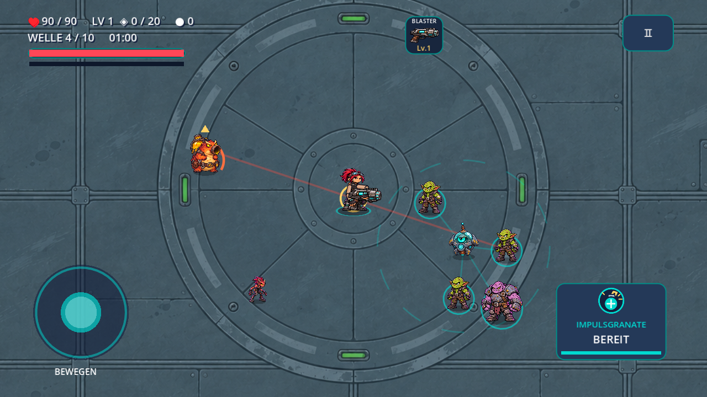

# RF Worlds — Mayhem Survivors 0.6.0

**Zwei neue Gegnerrollen in der Reaktorzone:**

- **Reaktorspucker** ab Welle 2: fixierte Ziellinie, 0,9 Sekunden Vorwarnung,
  einzelner langsamer Fernschuss. Keine Schüsse aus dem unsichtbaren Bereich.
- **Schilddrohne** ab Welle 4: 30 % Schutz für normale Gegner im Umfeld.
  Kein Stapeln/Bossschutz. Drohne ausschalten oder Gegner aus der Aura locken.

- [Android-APK 0.6 herunterladen](https://github.com/Whiskymitschuss/Match3/raw/refs/heads/feature/reactor-enemies-v0.6/Downloads/MayhemSurvivors-v0.6-debug.apk)
- [Vollständiges Quellprojekt ZIP](https://github.com/Whiskymitschuss/Match3/raw/refs/heads/feature/reactor-enemies-v0.6/Downloads/MayhemSurvivors-v0.6-source.zip)
- [Schussdarstellung](MayhemSurvivors/tests/roles_projectile.png) · [Vorbereitungshinweise](MayhemSurvivors/tests/roles_preparation.png)

Maximal 6 Spucker, 2 Drohnen und 2 gleichzeitige Schusswarnungen. Die Reaktor-Gegner-
zusammensetzung ändert sich bewusst; der Schrottplatz behält seine Gegner und Balance.
Alle Waffenentwicklungen, Fähigkeiten und Effekte bleiben enthalten.
Android 7.0+, ARM64, Querformat, offline; gleicher Paketname/Signierschlüssel,
versionCode 10. Als Update über bestehende App installieren, Statistiken bleiben erhalten.
Nur optionale Vibrationsberechtigung, keine Netzwerkberechtigung.

657 Assertions bestanden. Schrottplatz-Referenzen mit allen Waffenwegen/Fähigkeiten
bleiben identisch. Neue Rollen unter Last geprüft. Android-Praxisabnahme und Balancing
der erweiterten Reaktorzone sowie Geräte-FPS stehen noch aus.

[Anleitung](MayhemSurvivors/README.md) · [Testbericht](MayhemSurvivors/TEST_REPORT.md) ·
[Buildbericht](MayhemSurvivors/BUILD_REPORT.md) · [Fortschritt](MayhemSurvivors/PROGRESS.md)
