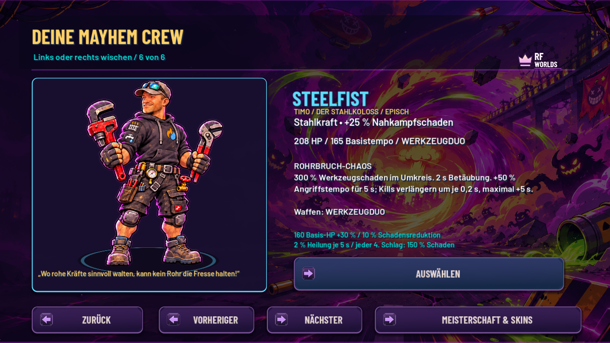

# RF Worlds — Mayhem Survivors0.17.0

**STEELFIST — DER STAHLKOLOSS. Timo ist als sechster Held sofort spielbar.**

- Werkzeugduo mit Schraubenschlüssel/Pumpenzange und jedem vierten Doppelschlag.
- 160 Basis-HP+30%=208 Start-HP,165 Tempo,10% Schadensreduktion und Regeneration.
- Rohrbruch-Chaos: Druckwelle,2s Stun, verlängerbarer Angriffstempobonus.
- Zwei Werkzeugentwicklungen, eigene Grafik/Icons/Sounds und komplette Menüintegration.
- Alle bisherigen Arenen, Helden, Endlos, Tages-/Wochenaufgaben und kostenloser Pass.

[Android-APK0.17 herunterladen](https://github.com/Whiskymitschuss/Match3/raw/refs/heads/feature/steelfist-v0.17/Downloads/MayhemSurvivors-v0.17-debug.apk)

[Vollständiges Godot-Quellprojekt ZIP](https://github.com/Whiskymitschuss/Match3/raw/refs/heads/feature/steelfist-v0.17/Downloads/MayhemSurvivors-v0.17-source.zip)

CHARAKTERE → bis STEELFIST wischen → AUSWÄHLEN → Arena betreten. Als Android-Update
installieren: ARM64, Android7+, Querformat, offline, Code21, gleiches Paket/Debug-Zertifikat.
Alte Profile und Studio-Coins bleiben kompatibel, neue Hero-Statistik beginnt leer.

23 Suites /1.747 Assertions und beide historischen Traces bestanden. 43.200 Lastschritte,
acht native Ansichten, APK-Signatur/Alignment/Payload geprüft. Physischer Android-Test
von Bedienung, neuer Tank-Balance und FPS/Thermik noch offen.

[Anleitung](MayhemSurvivors/README.md) · [Tests](MayhemSurvivors/TEST_REPORT.md) ·
[Build](MayhemSurvivors/BUILD_REPORT.md) · [Fortschritt](MayhemSurvivors/PROGRESS.md)
