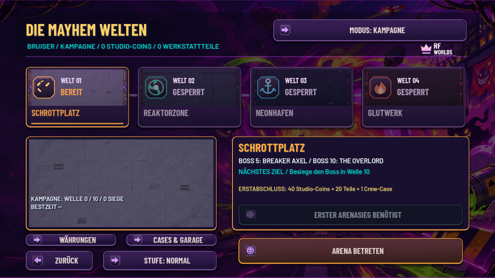
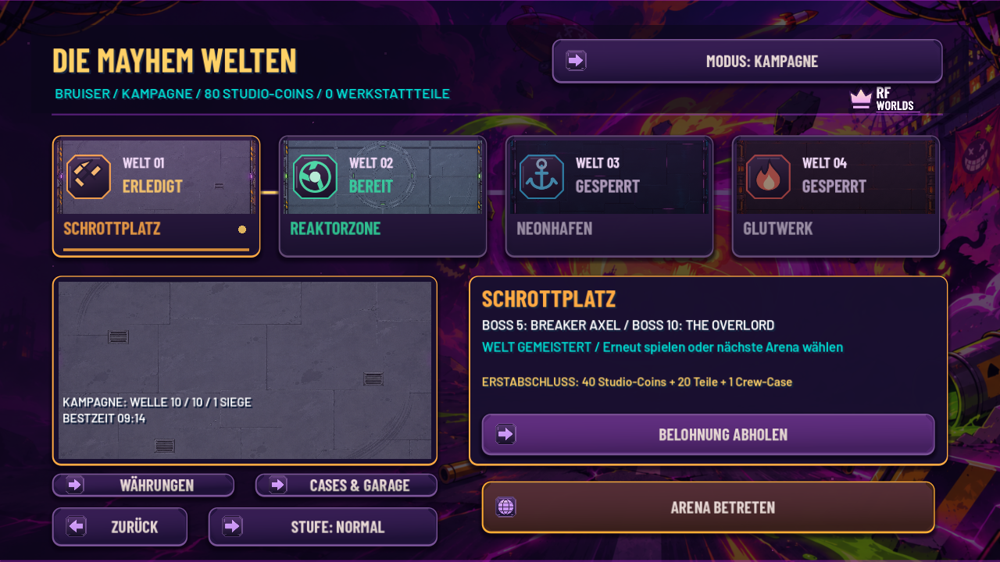
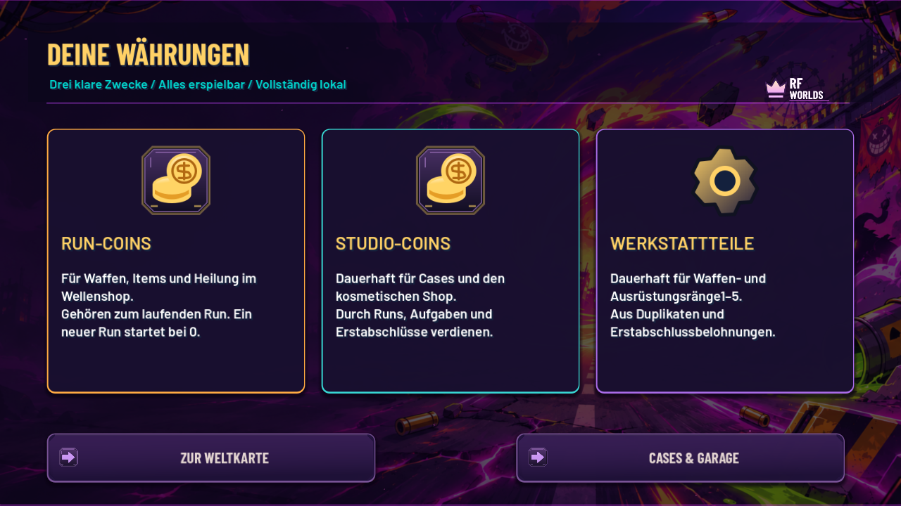

# RF Worlds — Mayhem Survivors0.20.0 / DIE MAYHEM WELTEN

Weltkarte und klare Kampagnenfreischaltung:
**Schrottplatz → Reaktorzone → Neonhafen → Glutwerk.**
Ein Kampagnensieg in Welle10 öffnet die nächste Arena. Je Welt einmalige Belohnung
mit Studio-Coins, Werkstattteilen und Case-Tickets. Neue Profile starten auf Welt1;
Altprofile behalten explizite Freigaben und bereits gespielte Arenen. Echte alte
Siege bleiben erhalten und erhalten eine abholbare Erstbelohnung.

[Android-APK0.20 herunterladen](https://github.com/Whiskymitschuss/Match3/raw/refs/heads/feature/world-map-v0.20/Downloads/MayhemSurvivors-v0.20-debug.apk)

[Vollständiges Godot-Quellprojekt ZIP](https://github.com/Whiskymitschuss/Match3/raw/refs/heads/feature/world-map-v0.20/Downloads/MayhemSurvivors-v0.20-source.zip)

[SHA256-Prüfsummen](https://github.com/Whiskymitschuss/Match3/raw/refs/heads/feature/world-map-v0.20/Downloads/SHA256SUMS-v0.20.txt)

Über0.19 installieren. SPIELEN → Fighter → Weltkarte. Nach dem Sieg WELTKARTE /
BELOHNUNG öffnen und das Geschenk abholen. Cases/Garage und Währungshilfe direkt
von der Karte. Die erste Welt gibt40 Studio-Coins +20 Teile +1 Crew-Ticket, zusätzlich
zur normalen Run-Belohnung. Vorhandene Sammlung/Coins/Statistiken bleiben erhalten.

27 Testsuiten /2.256 Prüfungen und beide historischen Traces bestanden.112 neue
Checks,12 native Ansichten inklusive Breitbild/Tablet und Speicherfehler. APK gebaut,
signiert, Alignment/Manifest/ARM64/Payload geprüft. Physischer Android-/Touch-/Sensor-/
FPS-/Thermik- und menschlicher Balancetest offen.

[Anleitung](MayhemSurvivors/README.md) / [Tests](MayhemSurvivors/TEST_REPORT.md) /
[Buildbericht](MayhemSurvivors/BUILD_REPORT.md) / [Fortschritt](MayhemSurvivors/PROGRESS.md).
Alle GDScript-Dateien, Daten, Szenen und Laufzeitassets im Quellarchiv; keine privaten
Schlüssel oder Importcaches. Vorherige Downloads bleiben unverändert.
